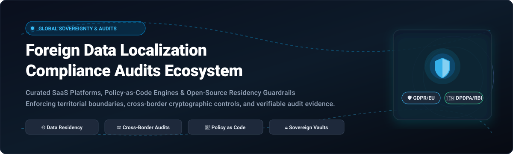

# 🌍 Awesome Foreign Data Localization Compliance Audits 🛡️

  

  
  
  
  
  
  

## 🧭 Curated Foreign Data Localization & Compliance Audits Ecosystem

> **A comprehensive, SEO-optimized knowledge index of enterprise SaaS platforms, open-source policy engines, and data residency guardrails.**  
> *Enforcing cross-border data protection, sovereign boundaries, cryptographic custody, and verifiable regulatory audit trails across GDPR, India DPDPA & RBI, China PIPL, EU AI Act, and KRITIS.*

**Last updated:** October 2026 📅

---

### 🔍 Overview & Architecture

This repository tracks notable **SaaS platforms** and **open-source policy-as-code frameworks** for **Foreign Data Localization Compliance Audits**. These tools empower global enterprises, platform architects, DevSecOps teams, and compliance officers to:
- 🌐 Enforce data sovereignty boundaries and geopolitical isolation.
- 🔀 Restrict and inspect cross-border data flows and international transfers.
- 🔐 Isolate PII, PHI, and sensitive financial records in localized sovereign data vaults.
- 📑 Generate non-repudiable, cryptographic, audit-ready compliance proof across complex regulatory mandates.

---

## 📑 Table of Contents

- [📊 Sector Overview & Market Dynamics](#-sector-overview--market-dynamics)
- [🏢 SaaS/Hosted Platforms](#-saashosted-platforms)
- [💻 Open-Source GitHub Projects](#-open-source-github-projects)
- [🛠️ Architectural Composition & Frameworks](#-architectural-composition--frameworks)
- [🤝 How to Contribute](#-how-to-contribute)
- [💖 Support & Sponsorship](#-support--sponsorship)
- [📈 Star History](#-star-history)
- [⚠️ Disclaimer](#-disclaimer)

---

## 📊 Sector Overview & Market Dynamics

The global data privacy, sovereign cloud governance, and data localization compliance software market is estimated at approximately **$5.3B–$6.6B**, projected to surge past **$25B–$30B+ by the early 2030s** driven by aggressive geopolitical regulatory enactments (including the EU GDPR & AI Act, India's DPDPA & RBI mandates, Saudi Arabia/Gulf PDPL, China's PIPL, and regional NIS2/KRITIS directives). 

The market remains **moderately to highly fragmented** rather than winner-take-all. Because international compliance demands varied domain specializations—ranging from code-level infrastructure scanning and admission gatekeepers, to cryptographic vaulting, consent orchestration, and localized cloud points-of-presence—no single monolithic provider monopolizes global compliance.

---

## 🏢 SaaS/Hosted Platforms

The following enterprise platforms provide managed, turn-key solutions for global data residency, discovery, privacy orchestration, and continuous audit verification, sorted descending by company scale:

| Platform | Company Size (Valuation / Revenue) 🏢 | Starting Pricing 💳 | Free Tier / Trial Limits ⏳ | Key Capabilities & Description 📋 |
| :--- | :--- | :--- | :--- | :--- |
| **[OneTrust DataGuidance](https://www.onetrust.com/)** | $4.5B valuation (~$500M+ ARR) | ~$10,000/year platform minimum (modular quotes per user/jurisdiction) | 14-day sales-assisted trial (no self-serve free tier; sandbox environments restricted to qualified enterprise evaluations) | Enterprise privacy management with regulatory research across 300+ jurisdictions, consent management, DSR automation, and data mapping. |
| **[Securiti.ai](https://securiti.ai/)** | $1.725B valuation (Acquired by Veeam for $1.725B; ~$75M+ ARR) | ~$25,000/year (custom enterprise subscription based on connectors and scanned data volume) | 14-day guided sandbox / POC upon sales approval (no permanent free tier; developer firewalls under separate community trials) | Data privacy and AI governance platform with regional boundary enforcement, data discovery, classification, and policy enforcement across cloud environments. |
| **[BigID](https://bigid.com/)** | $1.0B valuation (~$100M+ ARR) | ~$15,000/year (Express tier; enterprise deployments scale via custom private offers) | Scoped free risk assessment / shadow AI scan upon sales request (no permanent free tier or automated self-serve trial) | Data intelligence platform for privacy, security, and governance. Features data discovery, classification, and jurisdiction-aware policy enforcement across structured and unstructured data. |
| **[Immuta](https://www.immuta.com/)** | $1.0B valuation (~$60M+ ARR) | ~£1,000/user/year (~$1,300/user/year; typical minimum enterprise commitments start at ~$25,000–$50,000/year) | 14-day guided proof-of-concept (POC) sandbox upon sales review (no self-serve free forever plan) | Data access governance platform with policy enforcement, data masking, and audit trails for cloud data platforms. |
| **[TrustArc](https://trustarc.com/)** | ~$300M+ valuation (Private equity-backed; $109M+ funded; ~$50M ARR) | ~$10,000/year (Privacy Studio entry module; scales based on regulatory modules and domains) | 30-day limited trial access upon request (for Nymity regulatory intelligence database; no permanent free tier) | Privacy compliance platform with regulatory assessment, data mapping, and cross-border transfer management. |
| **[Skyflow](https://www.skyflow.com/)** | ~$200M valuation ($101M funded; ~$20M–$25M ARR) | ~$1,500/month (~$18,000/year entry tier; median enterprise contracts ~$195,000/year scaled by protected records) | 14-day developer sandbox trial upon request (covers test vaults and API tokens; no permanent production free tier) | Data privacy vault with regional data residency enforcement. Stores PII in isolated data vaults per jurisdiction with granular access controls. |
| **[Privacera](https://privacera.com/)** | ~$150M–$200M valuation ($67.3M funded; ~$25M–$38M ARR) | ~$20,000/year (PrivaceraCloud baseline subscription; scales by compute nodes and data volume) | 30-day free trial of PrivaceraCloud (limited to 5 connected cloud data sources and sandbox compute) | Data security and governance platform with fine-grained access control, data masking, and policy enforcement across cloud data platforms. |
| **[Transcend](https://transcend.io/)** | ~$150M valuation ($90M funded; ~$16M ARR) | ~$10,000/year (starter compliance tier; mid-market bundles average ~$50,000+/year) | 14-day interactive demo sandbox upon sales validation (no permanent free tier) | Privacy infrastructure platform with DSR automation, consent management, and data mapping with residency controls. |
| **[Ketch](https://www.ketch.com/)** | ~$100M–$150M valuation ($43M funded; ~$9M ARR) | $0/month (Free Tier); Starter paid tier starts at $150/month ($1,800/year) | Free tier: Up to 5,000 monthly unique visitors (includes CMP, preference center, 2 integrations); 30-day free trial on paid plans | Privacy automation platform with consent management, data subject rights, and cross-border transfer policy enforcement. |
| **[InCountry](https://incountry.com/)** | ~$60M–$100M valuation ($66M funded; ~$10M–$14M ARR) | ~$2,500/month (~$30,000/year entry tier per regulated country point-of-presence) | 30-day sandbox evaluation trial upon request (for localized storage APIs and AgentCloak; no perpetual free tier) | Data residency-as-a-service platform. Stores regulated data in-country while applications remain global. Features local encryption, key management, and compliance with data localization mandates. |

---

## 💻 Open-Source GitHub Projects

Curated open-source repositories for self-hosted data localization, policy-as-code enforcement, sovereign AI governance, and infrastructure audits. Sorted descending by GitHub star count:

- **[OpenMetadata](https://github.com/open-metadata/OpenMetadata)**   
  Unified metadata platform for data governance, automated data discovery, data lineage, and geolocation residency classification. Enables teams to tag tables and columns with regional sovereignty attributes and audit cross-region pipeline movements across modern data lakes.

- **[DataHub](https://github.com/datahub-project/datahub)**   
  Extensible metadata search and data governance architecture originally created at LinkedIn. Provides deep lineage tracking, automated compliance tagging for regional boundary enforcement, and audit logs tracking data residency changes across multi-cloud environments.

- **[Open Policy Agent (OPA)](https://github.com/open-policy-agent/opa)**   
  General-purpose policy engine that enables unified, context-aware policy-as-code enforcement across cloud services, microservices, and databases. Serves as the foundational enforcement engine for evaluating whether API transactions, database queries, and storage operations comply with territorial residency rules.

- **[Microsoft Presidio](https://github.com/data-privacy-stack/presidio)**   
  Context-aware PII detection, redaction, and de-identification SDK. Used extensively in sovereign data pipelines to detect sensitive jurisdictional records before egressing across national borders or passing into third-party LLMs.

- **[Checkov](https://github.com/bridgecrewio/checkov)**   
  Static code analysis tool for Infrastructure as Code (Terraform, CloudFormation, Kubernetes, ARM, Bicep). Validates cloud resource configurations against data sovereignty policies, ensuring cloud storage buckets, databases, and compute nodes are strictly deployed in designated sovereign geopolitical zones.

- **[OPA Gatekeeper](https://github.com/open-policy-agent/gatekeeper)**   
  Validating and mutating webhook admission controller that enforces OPA CRD-based policies in Kubernetes clusters. Guarantees that workloads, persistent volumes, and node selectors strictly adhere to geographic and sovereign boundary requirements before pods are scheduled.

- **[Conftest](https://github.com/open-policy-agent/conftest)**   
  Utility for writing tests against structured configuration data using Rego. Enforces regional data localization guardrails directly in CI/CD pipelines against Kubernetes manifests, Terraform plans, and server configurations prior to production deployment.

- **[Fides](https://github.com/ethyca/fides)**   
  Privacy-as-code platform providing automated data mapping, consent management, and data subject requests (DSAR). Built for developers and privacy engineers to declare data types, track categories, and enforce jurisdictional data retention rules directly inside application codebases.

- **[GovLLM](https://github.com/JehanneDussert/govllm)**   
  Continuous LLM governance and compliance monitoring framework for regulated environments (EU AI Act, GDPR, ANSSI). Self-hosted and profile-driven, verifying that no sensitive AI prompts or embeddings leave designated sovereign infrastructure.

- **[Azure Sovereign AI Landing Zone (SAIL)](https://github.com/Azure/SAIL)**   
  Infrastructure-as-Code deployment template engineered to deploy LLMs with total in-region compute and data sovereignty. Designed for highly regulated banking, healthcare, and public sector organizations that prohibit offshore egress.

- **[Borderlint](https://github.com/iolairus/borderlint)**   
  Developer tool for mapping where AI data and embeddings flow across networks and governing those telemetry paths against strict geographic residency and digital sovereignty policies.

- **[Admina Residency Enforcer](https://github.com/admina-org/admina)**   
  Lightweight Python module for zone-based data residency validation. Enforces allowed geographic zones (e.g. `["local", "eu"]`), blocks unauthorized outbound data serialization, tracks violation statistics, and returns structured dataclass audit reports.

- **[Semantic Firewall](https://github.com/hbauzan/semantic-firewall)**   
  Local-first semantic firewall for LLMs and RAG architectures. Analyzes 1024D embedding geometry to enforce data sovereignty and intercept prompt injections completely offline without external cloud dependencies.

- **[rbi-compliance-scanner](https://github.com/swayam-crypto/terraform-rbi-compliance-scanner)**   
  Specialized Terraform static analysis tool checking infrastructure code against **Reserve Bank of India (RBI) cybersecurity guidance and India's DPDPA data protection requirements**. Encodes rules such as detecting S3 buckets storing payment data provisioned outside `ap-south-1`.

- **[Edge Policy Hub](https://github.com/acailic/edge-policy-hub)**   
  ABAC policy engine with data residency guardrails using OPA/Rego. Features multi-tenant hard isolation, HTTP(S) egress proxy with policy enforcement, signed append-only audit stores, and human-readable policy DSL compiling down to Rego.

- **[Federated Sovereignty](https://github.com/abhijit-ubale/Federated-Sovereignty)**   
  Kubernetes operator for geopolitical data residency enforcement. Uses OPA Gatekeeper to validate every Pod creation to strictly bind workloads to EU (GDPR) or regional clusters, featuring geographical map dashboards and auditable constraint histories.

- **[Sovereign Guard AI](https://github.com/GSS-creator/sovereign-guard-ai)**   
  Enterprise trust gateway equipped with deep packet inspection (DPI) to monitor AI traffic, detect cross-border data leakage, and store tamper-evident audit logs in edge-localized KV/D1 storage.

### 📦 Ecosystem Tools & Reference Architectures

- **[Sentinel Kernel](https://pypi.org/project/sentinel-kernel/)** — Sovereign decision records and in-process OPA/Rego evaluation for LLM agent systems. Operates air-gapped with quantum-safe signing (ML-DSA-65) to protect against US CLOUD Act exposure.
- **[tibet-audit](https://pypi.org/project/tibet-audit/)** — Jurisdiction-aware compliance scanner with 120 checks across 17 regulatory frameworks (including Gulf PDPL and GDPR), calculating compliance health scores (0-100) and cryptographic decision proofs.
- **[SemantixRAG](https://pypi.org/project/semantixrag/)** — Open-source RAG platform with PII scanning (via Presidio) and GDPR DSAR automation for document chunking and vector storage.
- **[ProvMap](https://provmap.com)** — Open dataset mapping 55+ cloud providers with certification statuses, regional data residency footprints, and parent-company CLOUD Act exposures.
- **[Data Sovereignty Stack (ossalt)](https://ossalt.com/guides/data-sovereignty-open-source-stack-2026)** — Blueprints for assembling EU-sovereign clouds using Hetzner/OVH/Scaleway, MinIO/Ceph, OpenBao, Keycloak, and PostgreSQL.

---

## 🛠️ Architectural Composition & Frameworks

To establish a comprehensive, self-hosted foreign data localization audit system:
1. **Infrastructure as Code Layer**: Enforce cloud region placement with [Checkov](https://github.com/bridgecrewio/checkov) and [rbi-compliance-scanner](https://github.com/swayam-crypto/terraform-rbi-compliance-scanner).
2. **Kubernetes Workload Layer**: Prevent offshore container deployment via [OPA Gatekeeper](https://github.com/open-policy-agent/gatekeeper) and [Federated Sovereignty](https://github.com/abhijit-ubale/Federated-Sovereignty).
3. **Data Discovery & Cataloging Layer**: Classify jurisdiction-sensitive datasets using [OpenMetadata](https://github.com/open-metadata/OpenMetadata) and [DataHub](https://github.com/datahub-project/datahub).
4. **Application & Network Egress Layer**: Inspect and sanitize payload transfers with [Microsoft Presidio](https://github.com/data-privacy-stack/presidio) and [Edge Policy Hub](https://github.com/acailic/edge-policy-hub).
5. **AI Sovereignty Layer**: Audit LLM inferences and prompt retention boundaries using [GovLLM](https://github.com/JehanneDussert/govllm), [Sentinel Kernel](https://pypi.org/project/sentinel-kernel/), and [Borderlint](https://github.com/iolairus/borderlint).

---

## 🤝 How to Contribute

Contributions are warmly welcomed! Help build the definitive open resource for foreign data localization compliance:

1. 🍴 Fork the repository.
2. 🌿 Create a feature branch (`git checkout -b feature/new-sovereignty-tool`).
3. 📝 Add or update entries in `README.md` keeping descriptions factual, concise, and linked to official repositories or sites.
4. ⭐ Add the GitHub stars badge for open-source repositories using the standard format.
5. 🚀 Submit a Pull Request with a clear description of the project and its relevance to data residency compliance.

---

## 💖 Support & Sponsorship

If you find this curated collection valuable for your compliance audits, research, or engineering workflows, please consider supporting the project:

- ⭐ **Star this repository** to help others discover it!
- 🍴 **Fork and share** with colleagues and DevSecOps / Privacy engineering communities.
- ☕ **Buy a coffee & sponsor**: Support continuous maintenance on the [GitHub Sponsor Dashboard](https://github.com/sponsors/ishandutta2007).

---

## 📈 Star History

---

## ⚠️ Disclaimer

- This is a **community-curated index** — provided for informational and architectural benchmarking purposes and does not constitute formal legal counsel.
- Systems handling sensitive customer data or regulated financial/health records must adhere to jurisdictional statutory mandates (GDPR, DPDPA, RBI, PIPL, HIPAA, KRITIS, etc.). Formal validation by accredited legal and compliance professionals is strongly advised.
- **Data residency is distinct from complete digital sovereignty**: True sovereignty requires end-to-end control across physical infrastructure ownership, key custody, administrative operational personnel locations, subcontractor supply chains, and immunity from extraterritorial laws (such as the US CLOUD Act).

---

  <b>Built for compliance officers, security architects, platform engineers, and sovereign cloud builders. 🚀</b>

